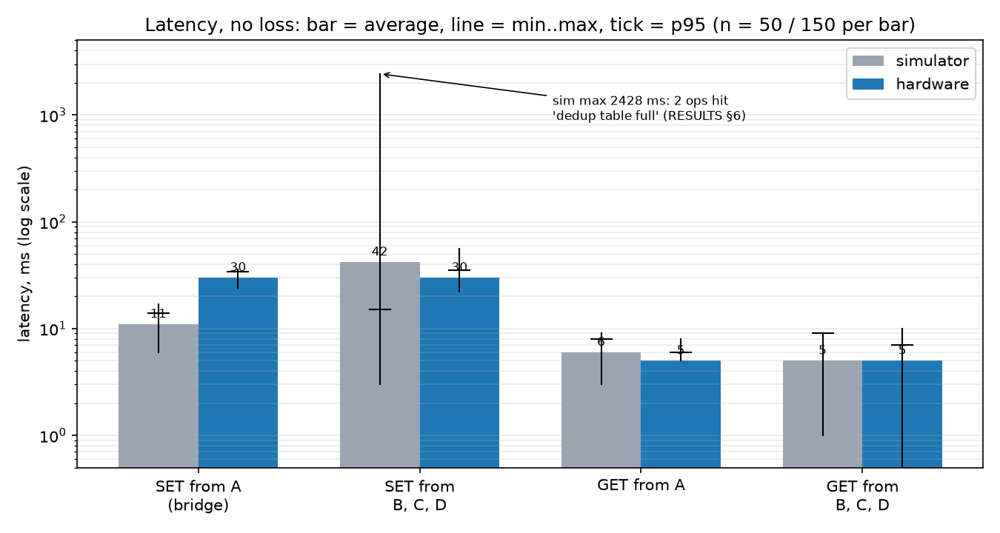
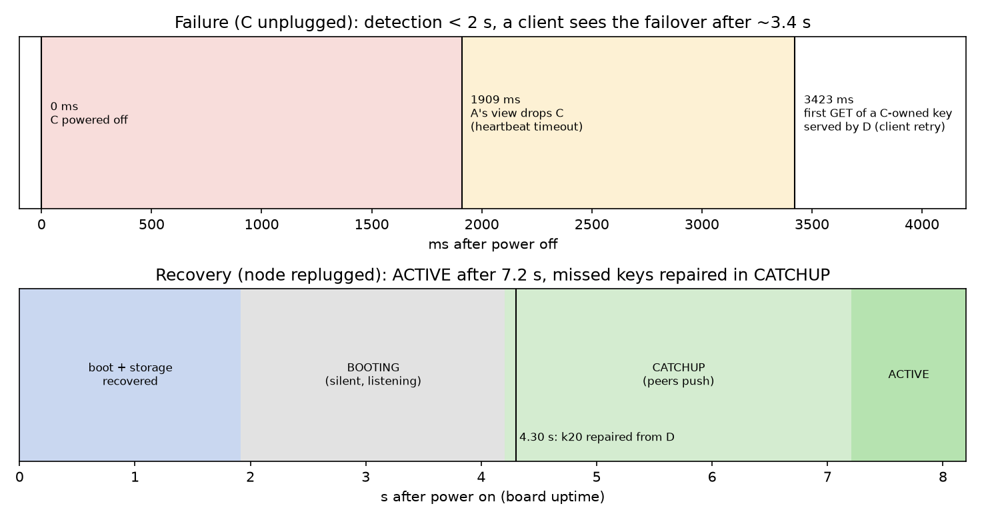
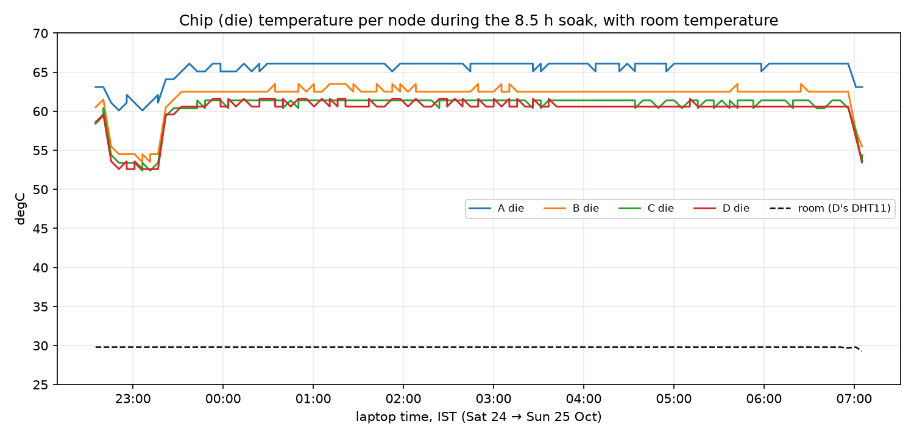

# Slides data

Every number and fact the presentation needs, in one place. Sources are in
brackets; all hardware numbers come from the boards in the bring-up of
Sun 18 – Sun 25 Oct 2026 (`docs/BRINGUP_LOG.md`, `docs/test-logs/`).
Charts: `docs/figures/` (regenerate with `scripts/make_figures.py`).

Times in the logs are the WSL clock (UTC); the laptop shows IST (UTC+5:30).

---

## 1. Architecture (one slide)

* **What:** a leaderless, replicated key-value store on **four ESP32-C3
  SuperMini** boards (nodes A–D), each with a **32 KB AT24C256 EEPROM**,
  talking over **ESP-NOW** (channel 6, static MAC table, single hop). Node A
  has a UART bridge for a Raspberry Pi. [DESIGN.md]
* **Placement:** consistent hashing (FNV-1a, 64 virtual points per node),
  **replication factor 2**: primary = first live node clockwise, replica =
  next live node. All 12 primary/replica pairs occur; primary share 21–30 %
  per node. [DESIGN §3]
* **Membership:** heartbeat broadcast every **500 ms**, peer dead after
  **2000 ms** without one; every node keeps its own view (no agreement
  protocol). [config.h]
* **Boot gate:** BOOTING (silent, 2.5 s listen) → CATCHUP (3 s: peers push
  what the node owns and lacks) → ACTIVE. A returning node never serves stale
  data. [DESIGN §4]
* **Versions:** hybrid logical clock (48-bit ms + 16-bit counter), merged on
  every packet; last-writer-wins. [DESIGN §5]
* **Writes:** any node takes any request and forwards it to the primary; the
  primary versions it, replicates to the replica (deadline 1.5 s), then
  answers. Client: up to 5 attempts, 3 s each. **Exactly once** through a
  64-entry dedup table that replays cached answers to retransmissions.
  [DESIGN §6]
* **Storage:** log-structured, two 16 KB banks with incremental compaction,
  CRC-16 + commit marker per record, torn-tail recovery; RAM index of up to
  64 keys per node. [DESIGN §7]
* **Repair:** anti-entropy every 10 s (version tables + pushes), tombstones
  with GC. [DESIGN §8]
* **Firmware:** one FreeRTOS node task owns all state (no locks); the
  DHT11 reads in its own low-priority task. C++17; the platform-independent
  code (everything but `src/platform/`) also runs in a 4-node simulator and
  host tests (`make check`: 32 host test programs + 40 Pi tests).

## 2. Hardware: BOM and pin map

| item | qty | used for |
|---|---|---|
| ESP32-C3 SuperMini | 4 | nodes A–D |
| AT24C256 EEPROM module (I2C, 32 KB) | 4 | one per node, all storage |
| GY-302 (BH1750) light sensor | 1 | node A |
| AM312 mini PIR | 1 | node B (**no output; B's motion is simulated**, problem 24) |
| LM393 sound module (DO + AO) | 1 | node C, DO (AO tried and dropped, see §11) |
| DHT11 3-pin module | 1 | node D |
| Raspberry Pi (UART to node A) | 1 | bridge; **not exercised on hardware yet** (kept off) |
| breadboards, jumpers, 4 USB-C data cables, laptop with WSL2 + usbipd | — | bench |

| SuperMini pin | every node | A | B | C | D |
|---|---|---|---|---|---|
| 3V3 / GND | EEPROM VCC / GND (A0–A2, WP → GND) | + BH1750 | + AM312 | + LM393 | + DHT11 |
| GPIO8 / GPIO9 | EEPROM SDA / SCL (400 kHz) | + BH1750 (0x23) on the same bus | | | |
| GPIO4 | | | AM312 OUT | LM393 DO (active-low) | DHT11 DATA |
| GPIO20 / GPIO21 | | UART RX / TX to the Pi | | | |

Rules learned: wire by silkscreen, not header position (problems 4, 17);
boards ≥ 20 cm apart, antenna end clear (problem 14); `format yes` on every
reused EEPROM module (problem 7). [BRINGUP §3.3]

## 3. Latency, simulator vs hardware

| operation | simulator min / avg / p95 / max (ms) | hardware min / avg / p95 / max (ms) |
|---|---|---|
| SET from A (bridge), n=50 | 6 / 11 / 14 / 17 | **24 / 30 / 34 / 36** |
| SET from B, C, D, n=150 | 3 / 42 / 15 / 2428 | **22 / 30 / 35 / 56** |
| GET from A, n=50 | 3 / 6 / 8 / 9 | **5 / 5 / 6 / 8** |
| GET from B, C, D, n=150 | 1 / 5 / 9 / 9 | **0 / 5 / 7 / 10** |
| ops needing > 1 attempt | 2 of 400 | **0 of 400** |

* A hardware SET is ~+19 ms: it waits for the primary's EEPROM append with
  write-verify and the replica's; the simulator's EEPROM is instant.
* GETs match: one EEPROM record read, no replication.
* The simulator's 2428 ms max: 2 ops hit "dedup table full" (64 entries,
  ~20 mutations/s per node). [RESULTS §1, §6]
* Under load (`bench 50` ×3 per node, Sat 24): avg 27–37 ms, max 35–81 ms
  on all four nodes.

## 4. Failover timeline (victim C, Tue 20; H-tests Sun 25)

| event | simulator | hardware |
|---|---|---|
| power off → peers' view drops C | 1907 ms | **1909 ms** |
| power off → first GET of a C-owned key served (by D) | 3407 ms | **3423 ms** |
| writes to C-owned keys while C is down | 10 OK of 10 | **10 OK of 10** |
| C power-on → ACTIVE | 5500 ms | **7210 ms** (board uptime, incl. 1.5 s console delay + EEPROM recovery) |
| keys written while down, readable from C after | 10/10 | **10/10** |

H-tests on the boards (Sun 25), all **pass**:

| test | result |
|---|---|
| H6 replica dies during a write | `UNDER_REPLICATED` after 1504 ms (1 attempt); view `A-CD` 1.9 s after the unplug; next SET OK in 25 ms with a stand-in replica; on return `k20 repaired from D` at 4.3 s, ACTIVE 7.2 s |
| H7 primary dies | GET and SET served by the old replica (B); ring: primary B, replica D |
| H8 primary returns | **89 GETs during outage and rejoin, 0 stale reads**; A repaired the key from B in CATCHUP before serving |
| H9 delete while a replica is down | `NOT_FOUND` from all four after rejoin and 3 sync rounds; tombstone on the returning node, never the old value |
| H4 lost SET_REQ / SET_ACK / REPL_ACK | every SET OK in 1 attempt; primary executed +1, replica applied +1 per SET; cached replies replayed |
| H5 duplicated request | executed once, `suppressed` +1 |
| H10 stale version from a peer | rejected (`resync stale` +1), value unchanged |
| H12a all four power-cycled | 4 keys (primaries on A, C, D) read back from every node |
| H12b power cut 1.0 s into a compaction | `storage recovered`, same 14 keys, no version went backwards |
| H1–H3, H11, H13 | earlier (Tue 20; soak Sat 24) |

Why a client needs ~3.4 s although detection takes < 2 s: the GET in flight
waits out its 3 s attempt deadline before retrying on the next owner. A
shorter deadline would cut this but cause false timeouts under loss.
[RESULTS §2, §6; BRINGUP_LOG M8, M12, M13]

## 5. Format and refill (anti-entropy)

* **H11 (Tue 20):** `format yes` on live node B: **32/32 owned keys back at
  the same version, 0 missing, 0 extra**; erase ~2 s, BOOTING → CATCHUP
  2.5 s, last repair 3.4 s, ACTIVE 5.6 s; 35 repairs pushed by A, C, D.
* **Fresh parallel format of all four (Sat 24):** `format yes` sent to all four
  at the same instant, `storage formatted` within 1 ms; ACTIVE `ABCD` within
  5.5 s; 0/64 keys and 0 test keys after 70 s; storage errors 0.
  [RESULTS §2b, BRINGUP_LOG step 3]

## 6. Loss tolerance (fault-injection images, Sat 24)

| injected frame loss | bench from | ok / failed | latency min / avg / max (ms) | simulator avg / max |
|---|---|---|---|---|
| 10 % | A | **50 / 0** | 26 / 342 / 1828 | 444 / 3406 |
| 10 % | B | **50 / 0** | 26 / 235 / 909 | 256 / 1814 |
| 20 % | A | **50 / 0** | 27 / 628 / 3720 | 731 / 5211 |
| 20 % | B | **50 / 0** | 25 / 806 / 3710 | 821 / 3414 |

Extra client attempts / duplicates answered from the dedup cache: 10 %: 2 / 18;
20 %: 7 / 59. **Every write executed exactly once; 0 failed.** Demo
rehearsal (Sun 25), 20 % from A: 50 / 0, avg 608 ms, max 4904 ms. [RESULTS §3]

## 7. Overnight soak (Sat 24 17:05 → Sun 25 01:35 UTC, 8 h 30 min)

| metric | A (light) | B (motion, simulated) | C (sound) | D (temp) |
|---|---|---|---|---|
| reboots | 0 | 0 | 0 | 0 |
| samples (30 s period) | 1026 | 1025 | 1025 | 1024 |
| writes committed | 100 % (1 under-replicated) | 100 % | 100 % | 100 % |
| failed writes / client ops | 0 / 0 | 0 / 0 | 0 / 0 | 0 / 0 |
| storage errors | **1** (`I2C_ERROR`, repaired in 4 s) | 0 | 0 | 0 |
| compactions (aborted) | 16 (0) | 18 (0) | 13 (0) | 28 (0) |
| sensor read failures | 0 | 0 | 0 | 21 (never stale) |
| radio queue overflows | 0 | 0 | 0 | 0 |
| heap min | 164 KB | 170 KB | 166 KB | 166 KB |

* All 98 five-minute polls answered by every node.
* One radio episode (01:01–01:05 IST, nobody present): 22 view changes, no
  error, no lost write (6 replication attempts retried).
* Frames from unknown MACs on every node, steady ~0.15/s (some other 2.4 GHz
  sender nearby), filtered. [RESULTS §4, BRINGUP_LOG M10]

## 8. EEPROM wear

| node | hottest page writes in 8.6 h | years to the 1M-cycle rating |
|---|---|---|
| A | 61 | **16.1** |
| B | 68 | **14.4** |
| C | 49 | **20.0** |
| D | 98 | **10.0** |
| simulator (H13, 2 h, 5 reboots) | 27 in 2 h | 8.5 |

Why the hardware is better than the simulator estimate: both count page write
cycles the same way, but the simulator's run was 2 h with a reboot every
20 min, so formatting and catch-up writes dominate its rate; the soak is
8.6 h of steady state. D wears fastest and also compacted most (28 vs 13–18
on the others); which keys drive that was not analysed. At 30 s sampling
every node lasts ≥ 10 years. [RESULTS §5]

## 9. Chip (die) temperature

| node | min / median / max (°C), 198 readings | |
|---|---|---|
| A | 60.1 / 66.1 / 66.1 | runs hottest: the bridge node |
| B | 53.5 / 62.5 / 63.5 | |
| C | 52.4 / 61.4 / 61.4 | |
| D | 52.6 / 60.6 / 61.6 | |
| room (D's DHT11) | 29.3 – 29.8 | |

* Read from the ESP32-C3's internal sensor in `status`/`stats`: **die
  temperature, not ambient** (23–36 °C above the room).
* Observation, not explained: all four dies switch between two levels about
  6–7 °C apart **at the same moments** (down 22:40 IST, up 23:15, down 07:00)
  while the room stays flat: a common external cause (e.g. the laptop's USB
  supply / power state), not per-board load.

## 10. F1 / F2: the storage-fault fix (problem 15)

Symptom: aborted compactions and storage errors on D whenever its DHT11 read
failed. Cause: the DHT11 read (interrupts off, tens of ms when the sensor
does not answer) ran inside EEPROM operations, and the write-cycle poll gave
up after 10 ms without a final check. Fixes: **F1** the DHT11 read holds the
I2C bus lock; **F2** one final ACK poll after the write-cycle deadline;
plus fault logging that names the error.

| DHT11 DATA unplugged on D, nobody touching | before (Wed 21, 10 min) | after (Sat 24, 17 min) |
|---|---|---|
| compactions during the test | 1 cycle | 2 |
| **aborted compactions** | **5** | **0** |
| **new storage errors** | **+7** | **+0** |
| fault lines logged | (no logging yet) | none |

| `bench 50` ×3 on D at 1 s sampling | avg | max | ok |
|---|---|---|---|
| before F1 (Wed 21) | 30.7 ms | 67 ms | 150/150 |
| after F1 (Sat 24) | **30.3 ms** | **66 ms** | 150/150 |

F1 costs no measurable latency. [BRINGUP_LOG step 5]

## 11. Problems found on the hardware (symptom → cause → fix)

1. Opening a console rebooted the board → `monitor_rts/dtr = 0` toggled the USB-JTAG reset → removed those settings.
2. `stats` silent on a board without EEPROM → it halts before the console starts → expected; docs corrected.
3. `reset reason: unknown` after upload → the USB-JTAG reset has no IDF reason code → documented (unknown = USB reset).
4. EEPROM not answering on A → wired by header position, not silkscreen → rewired by silkscreen (standing rule).
5. Boot text came back as console commands → host tty echoes the board's buffered output when a port opens → 1 s input hold at boot + "send an empty line first" rule.
6. B's EEPROM power unreliable → loose 3V3 header pin → resoldered.
7. Keys nobody wrote in B's store → reused EEPROM module from earlier tests (no deployment id) → deleted; `format yes` on every reused module.
8. 5 radio queue overflows on B → node task blocked ~2 s by a format erase → accepted (only during erase).
9. A console reply appeared only with the next output → USB-Serial-JTAG kept the tail in its 64-byte FIFO → flush 20 ms after the last output.
10. Console dropped commands mid-session → echo guard misread a stall as a port open → guard limited to boot.
11. Tombstones returned after compaction → anti-entropy pushed tombstones already marked for GC → skip them (test-first fix).
12. `measure.py` timed out waiting for an unplug → operator relay latency → `--event-timeout` (900 s on hardware).
13. Storage errors in the hundreds → test keys filled the 64-key index ("index full" reported as `STORAGE_ERROR`) → fresh format; `measure.py` deletes its keys.
14. Views flapped, 30–55 % of heartbeats lost → boards too close together → ≥ 20 cm apart, antenna ends clear.
15. Aborted compactions on D → DHT11 read inside EEPROM ops + write-cycle poll without final check → F1 + F2 + fault logging (§10).
16. D's EEPROM not answering after wiring → jumper with bad contact → reseated.
17. DHT11 never read → wired by position (VCC is the middle pin) → rewired by silkscreen.
18. B brownout reset at a plug-in → plug-in transient → watched; did not recur.
19. C rebooted while metering a pin → probe briefly loaded 3V3 → rule: meter powered-off boards.
20. C's storage failed to start after rewiring → EEPROM jumper contact → reseated.
21. C did not enumerate on USB → faulty laptop port → moved to another port.
22. A's console silent although A was alive → USB/IP link stalled during re-enumeration → replugged A.
23. 22 `I2C_ERROR`s on D in 15 s → EEPROM module hanging off the table, pulling its jumpers → reseated, module on the table.
24. B's PIR never fired → dead or miswired module (then reverse-polarised) → B's motion simulated; replace the PIR.

Also: C's LM393 analog output (AO) was too weak to use (a clap at 30 cm
stayed inside the ADC noise even with the pot turned), so C went back to the
digital output (DO), which hears a loud clap only within ~5 cm.

## 12. Limitations and future work

* **Sensors:** B's PIR is dead (simulated motion); C hears only very close
  claps → an amplified microphone (MAX9814 / MAX4466) on an ADC1 pin with the
  peak-to-peak logic already written (`a9f483f`); a full chip-temperature
  sensor kind was considered and deferred.
* **Pi bridge** not yet exercised on hardware (M6 / H14).
* **Capacity:** 64 keys per node; "index full" is reported as a generic
  `STORAGE_ERROR` (a distinct status is future work); ~20 mutations/s per node
  (dedup table).
* **Failover:** clients see ~3.4 s on a node failure (attempt deadline).
* **Radio:** heartbeats are broadcasts without retries, so RF loss shows as
  view flaps (placement-sensitive; one 4-min episode overnight); single hop,
  static MAC table.
* **Storage:** A shares its I2C bus with the BH1750; one `I2C_ERROR` in 8.5 h
  (repaired); no deployment id in the EEPROM superblock (reused modules carry
  old data).
* **Tooling:** `fault clear` prints `fault armed` (text only); consoles through
  usbipd miss a board's first ~6 s after a replug.
