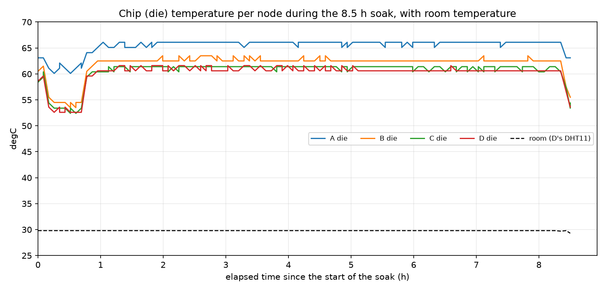

# Final report: data and attachments

Collected from the repo (no firmware changes, no boards connected).

## 1. Sensor values at the 5-min soak polls

Source: `docs/test-logs/soak-sat24.log`. Each value is from the `sensor … (hardware): on, … last <value>`
line of a `status` poll, which is the latest 30 s sample at that poll. The soak ran 8.5 h with
98 polls per node. The final collection after the soak ended isn't a poll, so it has its own
column.

| Sensor (node) | n | min | median | max | final collection after the soak ended |
|---|---|---|---|---|---|
| light, lux (A, BH1750) | 98 | 0.000 | 0.000 | 46.666 | 7.500 |
| temperature, °C (D, DHT11) | 98 | 29.7 | 29.8 | 29.8 | 29.3 |
| sound, events (C, LM393 **DO**) | 98 | 0 | 0 | 0 | 0 |

* Light: 88 of 98 polls read 0.000 lux (room dark). The 10 non-zero readings are
  46.666, 15.000, 13.333 (×5), 6.666 and 7.500 lux early in the soak (first ~0.9 h), and
  8.333 lux at the final poll.
* Temperature: 29.7–29.8 °C at every poll. The 29.3 °C reading is from the final collection
  after the soak ended, which is where RESULTS' "room 29.3–29.8 °C" lower bound comes from.
* Sound: 0 events and 0.0 % active at every poll. The soak ran the `40a8157` build with C on
  the LM393 **digital output** (mask `0x0D`), not the AO driver. Its sensitivity limit
  (loud clap within ~5 cm, M9c) means 0 is expected in a quiet room and doesn't show a fault.
* B's motion sensor was simulated in the soak (problem 24), so it is not in this table.

### Chip (die) temperature

`chip_temp_soak.png` is generated by `docs/report/make_chip_temp_elapsed.py` from
`docs/test-logs/soak-sat24.log`. The x-axis is elapsed hours from the start of the soak.
The values below are min / median / max over every `chip temp` reading in the log (`status`
and `stats` at each poll, plus the final collection; 198 readings per node).

| Node | min °C | median °C | max °C |
|---|---|---|---|
| A | 60.1 | 66.1 | 66.1 |
| B | 53.5 | 62.5 | 63.5 |
| C | 52.4 | 61.4 | 61.4 |
| D | 52.6 | 60.6 | 61.6 |

There are two drops. Early in the soak (about 0.2–0.8 h), B, C and D were 6–8 °C lower and
A 3 °C lower. All four then fell 3–7 °C again in the last ~10 min. Neither drop is explained
by the log: the log shows no reboot, view change or error at those points, and the room
reading stays at 29.7–29.8 °C during the early dip.

## 2. Dedup table size (ESP32-C3 build)

From the DWARF debug info of `.pio/build/node-a-fi/firmware.elf` (riscv32, `readelf
--debug-dump=info`). `src/`, `include/` and `platformio.ini` are unchanged since `2417e28`.

| Type | sizeof | Layout |
|---|---|---|
| `DedupManager::Entry` (one entry) | **96 B** | identity 8 @0, state 1 @8, response[64] @9, response_length 1 @73, (6 pad @74–79), started_at_ms 8 @80, completed_at_ms 8 @88 |
| `entries_[MAX_DEDUP_ENTRIES = 64]` (the table) | **6 144 B** | 64 × 96 |
| `DedupManager` (table + 3 × u64 timeouts + flag) | **6 176 B** | `entries_` at offset 24 |

90 of the 96 bytes per entry hold data (8 + 1 + 64 + 1 + 8 + 8). The other 6, at offsets
74–79, are alignment padding before the first `uint64_t` timestamp. The last member ends at
offset 96 = sizeof, so there is no tail padding.

## 3. Flash chip and app partition

* **Build configuration** (`board = esp32-c3-devkitm-1`): `flash_size 4MB`, QIO, 80 MHz.
  Partition table (from `partitions.bin`, Arduino default): `app0` ota_0 at 0x10000,
  **1 280 KiB (1 310 720 B)**; `app1` 1 280 KiB; spiffs 1 408 KiB; nvs 20 KiB; otadata 8 KiB;
  coredump 64 KiB.
  Image sizes (`firmware.bin`, `-fi`): A 863 296 B (65.9 % of app0), B 853 328 B (65.1 %),
  C and D 860 528 B (65.7 %).
* **Physical chip (`esptool flash_id`): NOT YET CONFIRMED.** No log in the repo records it,
  and the boards are unplugged. Needs the boards connected (see the bring-up log).

## 4. Attachments in this folder

* `chip_temp_soak.png`: chip temperature over the soak, x-axis in elapsed hours (see section 1).
* `make_chip_temp_elapsed.py`: the script that generates it.
* No photos or videos of the wired nodes exist.
